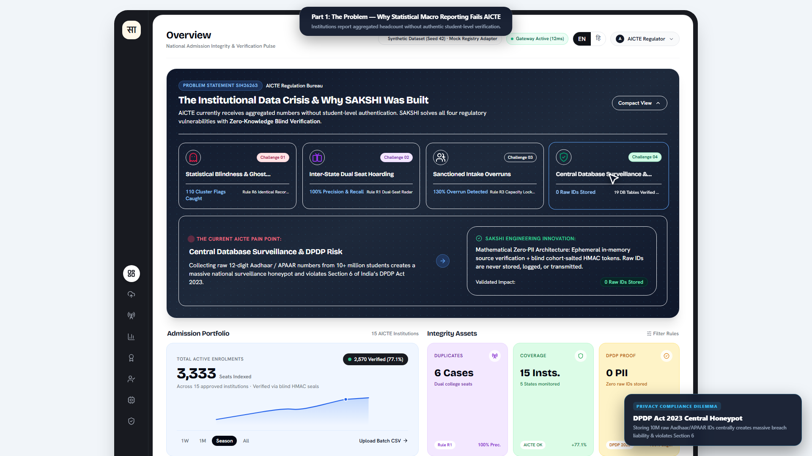
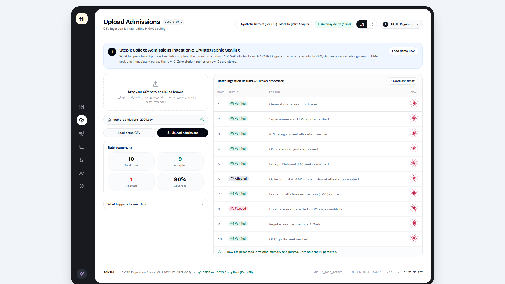
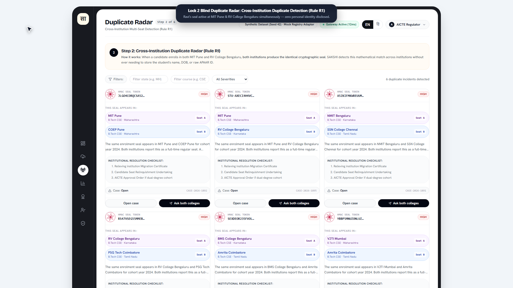
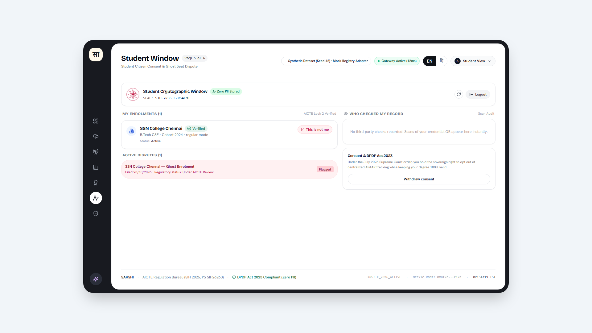
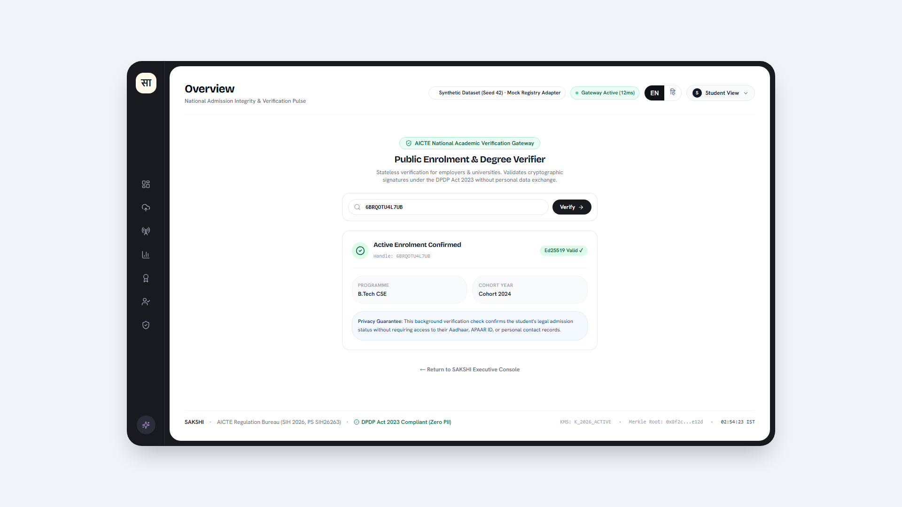
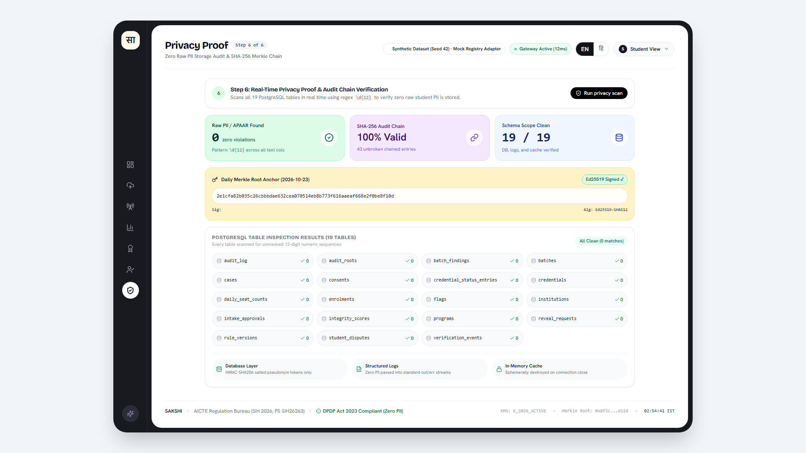

# SAKSHI

### Verify student enrolment without collecting student identity.

**SAKSHI** (Sanskrit for *witness*) is a prototype for AICTE student-enrolment integrity checks. It helps find duplicate enrolments, suspicious seats, and intake overruns while keeping student identity out of the regulator's central records.

> A witness that confirms, never discloses.

**Smart India Hackathon 2026 · AICTE · Problem Statement SIH26263**

> **Prototype notice:** This repository uses synthetic demo data and a mock registry adapter. It is not connected to a live APAAR registry or production AICTE systems.

## See the product

The screenshots below are from the web application. The dashboard and screens show synthetic data.

### Key product screens

<table>
  <tr>
    <td width="50%">
      <strong>Overview</strong><br>
      
    </td>
    <td width="50%">
      <strong>Admissions upload</strong><br>
      
    </td>
  </tr>
  <tr>
    <td width="50%">
      <strong>Duplicate radar</strong><br>
      
    </td>
    <td width="50%">
      <strong>Student window</strong><br>
      
    </td>
  </tr>
  <tr>
    <td width="50%">
      <strong>Credential verification</strong><br>
      
    </td>
    <td width="50%">
      <strong>Privacy proof</strong><br>
      
    </td>
  </tr>
</table>

## The problem

Colleges report student admission totals, but totals alone do not let a regulator confidently identify duplicate seats or verify whether reported enrolments are consistent. Collecting every student's identity in one central system creates a separate privacy risk.

## The idea

1. **Check at the source.** An institution submits an admissions batch. In this prototype, identity values are checked through a mock registry adapter and processed by the API.
2. **Keep a blind seal.** The identity is transformed into a keyed token; the system uses the token for matching instead of storing a raw ID in its enrolment record.
3. **Review, don't automatically punish.** Rules flag cases such as duplicate seals or intake anomalies with reasons for an authorised person to review. Institutions can be asked to resolve a potential match.
4. **Give students visibility.** The student-facing window supports reviewing enrolments and raising a dispute.
5. **Verify credentials separately.** A signed credential can be checked without a central lookup of a student's name.
6. **Inspect privacy and audit evidence.** The privacy proof and audit screens expose checks available in the demo system.

The application is a working prototype, not a production-ready national registry. Its data, integrations, and performance should be evaluated in that context.

## What you can explore

| Screen | What a viewer can see |
| --- | --- |
| **Overview** (`/overview`) | Institution and enrolment summary, integrity indicators, and recent incidents |
| **Admissions upload** (`/upload`) | Demo CSV ingestion, row-level results, and seals |
| **Duplicate radar** (`/radar`) | Potential duplicate enrolments represented by matching seals |
| **Integrity** (`/integrity`) | Rule-based institution-level integrity information and reasons |
| **Credentials** (`/credential`, `/verify`) | Issue or verify a signed demo credential |
| **Student window** (`/citizen`) | Student enrolment view and dispute workflow |
| **Privacy proof** (`/proof`) | Available database privacy scan and audit-chain checks |
| **Briefing and story** (`/briefing`, `/story`) | Animated explanation of the problem, approach, and demo scenarios |


## Run locally

### Requirements

- Python 3.11 or newer
- Node.js 18 or newer

### 1. Install the API dependencies and prepare demo data

From the repository root:

```bash
cd api
python -m pip install -r requirements.txt
cd ..
make seed
```

The seed command creates the database schema and deterministic synthetic demo data. It is intended for a fresh local demo database.

### 2. Start the API

In one terminal:

```bash
cd api
uvicorn main:app --reload --port 8000
```

The API is available at `http://localhost:8000`; interactive API documentation is at `http://localhost:8000/docs`.

### 3. Start the web app

In a second terminal:

```bash
cd web
npm install
npm run dev
```

Open `http://localhost:5173`. Start at the welcome page, choose **Watch the 2-minute story**, or choose **Explore the live system**.

### Optional: Docker Compose

```bash
docker compose up --build
```

## Run tests

From the repository root:

```bash
make test
```

## Technology

- **Web:** React, Vite, Tailwind CSS, Framer Motion, Three.js
- **API:** Python, FastAPI, Pydantic, SQLAlchemy
- **Local demo storage:** SQLite
- **Privacy and integrity mechanisms:** keyed HMAC tokens, signed credentials, and a hash-chained audit log

