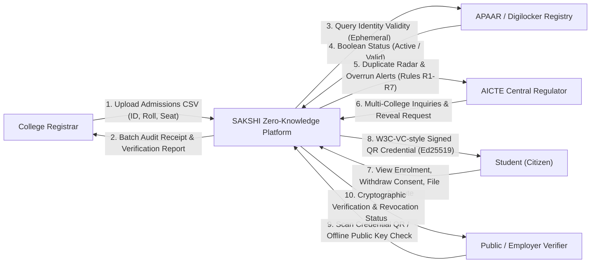
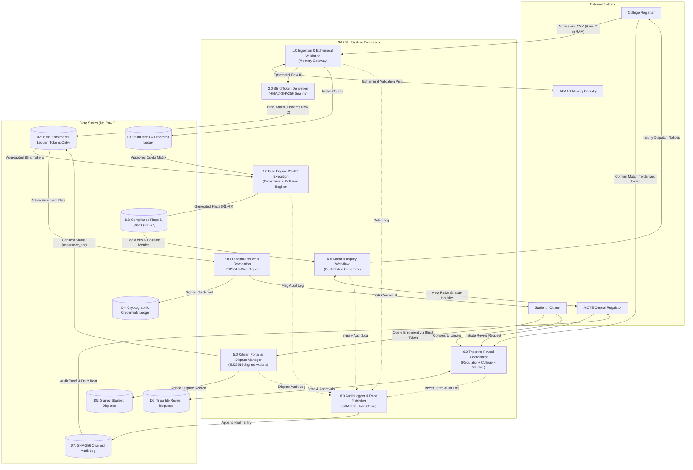

# SAKSHI — Data Flow Diagrams (DFD)

This document provides formal Data Flow Diagrams (DFD Level 0 and Level 1) for the **SAKSHI** (साक्षी) zero-knowledge enrolment verification platform.

---

## 1. DFD Level 0 — Context Diagram

The Level 0 context diagram demonstrates the boundary of the SAKSHI platform and its interactions with external entities: College Registrars, the AICTE Central Regulator, Students (Citizens), Employers/Public Verifiers, and the Mock/Live APAAR Identity Registry.

---

## 2. DFD Level 1 — Decomposed System Flow

The Level 1 diagram decomposes SAKSHI into its core internal processes and data stores, showing the zero-knowledge memory boundary where raw identifiers are converted into blind tokens and discarded.

---

## 3. Key Data Flow Architectural Guarantees

1. **Zero-Persistence Guarantee**: In Process `1.0` and `2.0`, raw student identifiers reside exclusively in volatile memory buffers for the duration of the HMAC computation and are immediately released. No column in `D1` through `D7` stores raw identifiers.
2. **Opt-Out & Consent Boundary**: If a student opts out or withdraws consent (`assurance_tier == 'pending'`), Process `3.0` (Rule Engine) excludes the record from cross-college collision detection in `D3`, preserving institutional count accuracy while preventing cross-institutional tracking.
3. **Audit Immutability**: All write operations through processes `1.0` through `6.0` append an entry to `D7` linking to the previous record's SHA-256 digest, anchored daily by an Ed25519-signed root.

