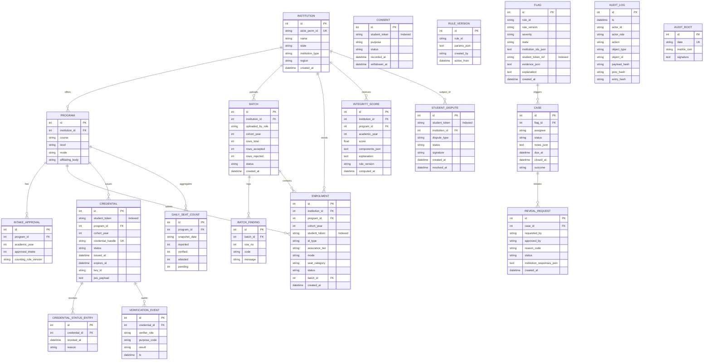

# SAKSHI — Entity-Relationship (ER) Diagram

This diagram visualizes the relational schema defined in [`api/models.py`](file:///e:/projects/sakshi%20sih%202nd/api/models.py).

### Fundamental Privacy Covenant
No table or column anywhere in this schema persists a raw student identifier (Aadhaar, APAAR ID, name, email, phone number, or date of birth). All cross-institutional correlations and citizen actions operate strictly through `student_token` (a one-way HMAC-SHA256 blind seal).

---

---

## Schema Architecture Notes

1. **Compound Indexing for Radar Performance**:
   - `ix_enrolment_token_cohort (student_token, cohort_year)` enables sub-10 ms detection across thousands of admissions.
   - `ix_enrolment_inst_prog_cohort (institution_id, program_id, cohort_year)` powers instant intake overrun checks.
2. **Cryptographic Signatures in Ledger**:
   - `STUDENT_DISPUTE.signature` stores HMAC/Ed25519 signatures of the citizen's dispute statement.
   - `AUDIT_ROOT.signature` stores Ed25519 signatures of the daily Merkle root for external auditability.
   - `CREDENTIAL.jws_payload` stores the compact Ed25519 JWS token for client-side and offline verification.
3. **Decoupled Identity**:
   - Neither `CONSENT` nor `STUDENT_DISPUTE` nor `REVEAL_REQUEST` requires raw identity data to operate securely.

