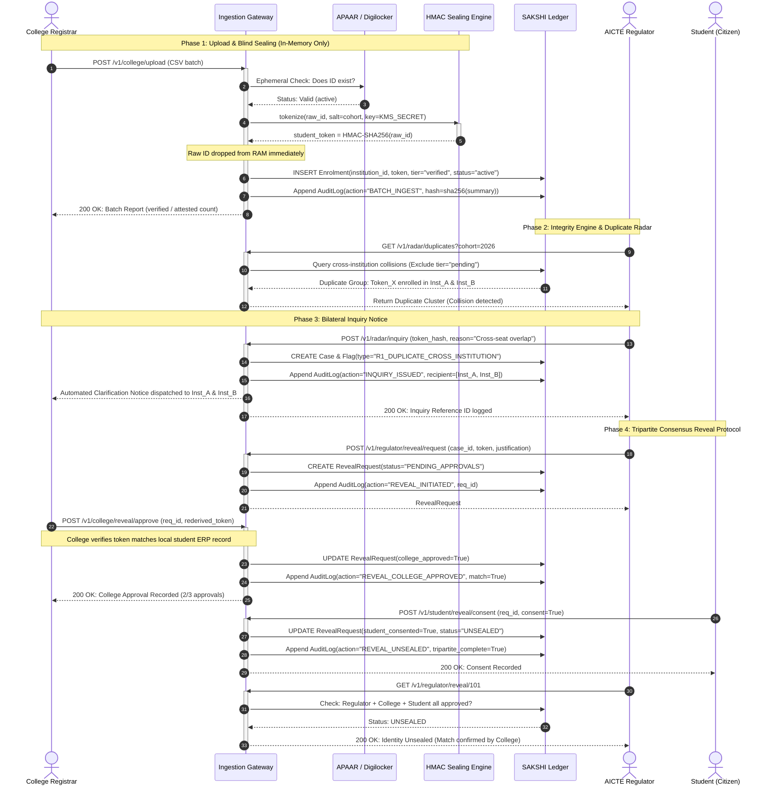

# SAKSHI — System Sequence Diagram

This sequence diagram illustrates the complete end-to-end operational lifecycle of student admission verification in SAKSHI:
**CSV Ingestion $\rightarrow$ Ephemeral APAAR Check $\rightarrow$ Blind Sealing $\rightarrow$ Rule Engine Detection $\rightarrow$ Duplicate Radar Alert $\rightarrow$ Bilateral Inquiry $\rightarrow$ Tripartite Dual-Control Reveal**.

---

---

## Key Protocol Milestones

1. **Ephemeral Boundary**: Lines 3–7 ensure that student IDs are held in memory only long enough to perform one cryptographic HMAC computation and verify existence against the registry.
2. **Deterministic Radar**: Lines 10–14 allow regulator oversight of multiple concurrent seat occupancies without decrypting student identity.
3. **Decentralized Resolution**: Lines 15–20 send automated notices to college registrars rather than performing invasive surveillance.
4. **Tripartite Consensus**: Lines 21–38 enforce that an identity unseal cannot be executed unilaterally by any single authority; it requires joint digital consent from regulator, college, and citizen.

