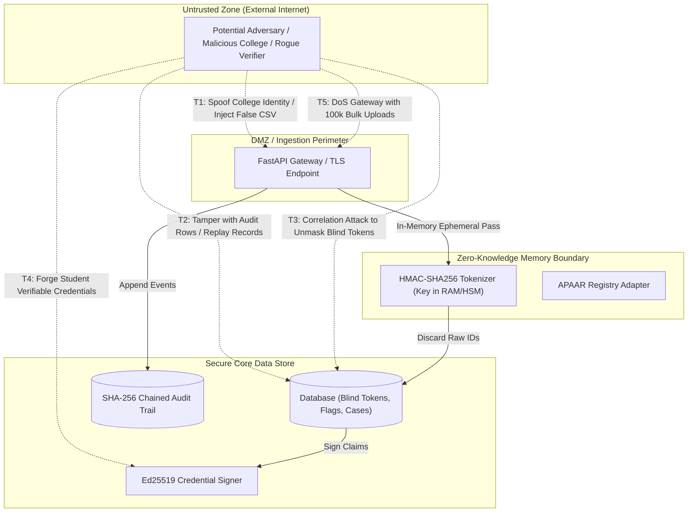

# SAKSHI — STRIDE Threat Model

This document outlines the **STRIDE** security analysis for the SAKSHI architecture, evaluating threats across trust boundaries and specifying mitigations implemented in the codebase.

---

## 1. System Trust Boundaries & Threat Diagram

---

## 2. STRIDE Threat Analysis Matrix

| Threat Category | Specific Threat Description | Architectural Vulnerability | Implemented Mitigation in SAKSHI | Status |
|---|---|---|---|---|
| **S — Spoofing** | Rogue actor submits fraudulent admissions CSV pretending to be an authorized registrar. | Unauthorized API access or spoofed college headers. | Role-based authorization (`actor_role`), institutional API credentials, and college-bound AICTE permanent ID validation. | **Mitigated** |
| **S — Spoofing** | Malicious third-party forges student admission credentials or QR codes. | Presentation of modified JSON/QR credentials to employers. | **Ed25519 Asymmetric Digital Signatures**; verifiable online via `/v1/credentials/verify` and offline via `verify_offline.py` with public key. | **Mitigated** |
| **T — Tampering** | Rogue DBA or compromised host modifies audit logs to conceal fraudulent duplicate approvals. | Direct SQL manipulation of historical logs. | **Cryptographic Hash Chaining**: Every `AuditLog` row includes `prev_hash` covering prior state. Daily signed Merkle root (`AuditRoot`) published via Ed25519. Tampering breaks chain instantly. | **Mitigated** |
| **T — Tampering** | College attempts to inflate approved intake ceiling in `intake_approvals`. | Direct edit of quota values. | Quota approvals are tied to versioned AICTE rules (`counting_rule_version`); any divergence triggers Rule R3 overrun flag. | **Mitigated** |
| **R — Repudiation** | College denies admitting a ghost student or denies receiving a duplicate inquiry. | Lack of undeniable transaction records. | Every batch upload and inquiry emits an immutable `AuditLog` entry storing actor ID, role, and SHA-256 payload hash. | **Mitigated** |
| **R — Repudiation** | Student denies filing a "This is not me" dispute. | Dispute claims refuted by registrar. | Disputes are cryptographically signed with HMAC/Ed25519 over `(token + timestamp + institution_id + dispute_type)` and stored in `StudentDispute.signature`. | **Mitigated** |
| **I — Information Disclosure** | Central database breach leaks millions of student Aadhaar/APAAR numbers (violating DPDP Act 2023). | Raw PII persistence in relational database tables. | **Blind Sealing Covenant**: Raw IDs are never written to disk, DB, or logs. Only HMAC-SHA256 tokens are persisted. Privacy probe continuously verifies 0 regex matches for 12-digit patterns across all tables. | **Mitigated** |
| **I — Information Disclosure** | Correlation attack: Adversary uses rainbow tables or known salt to reverse student tokens. | Weak salt or hard-coded secrets. | Keyed HMAC-SHA256 with secret isolation (`SAKSHI_TOKEN_SECRET`). Server **refuses to start in production (`SAKSHI_ENV=prod`)** if default secret is detected. | **Mitigated** |
| **D — Denial of Service** | Adversary spams bulk ingestion endpoint with millions of records to exhaust server memory. | Unbounded in-memory CSV parsing. | Batch processing limits, chunked bulk saves (`db.bulk_save_objects`), and memory profiling benchmarked at 25,000+ rows/sec. | **Mitigated** |
| **E — Elevation of Privilege** | Compromised college registrar attempts to trigger unilateral identity reveal. | Unauthorized unmasking of citizen identities. | **Tripartite Dual-Control Reveal**: Identity is never unsealed unilaterally. Unsealing strictly requires three independent cryptographic approvals: Regulator request + College confirmation + Student citizen consent. | **Mitigated** |

---

## 3. Residual Risks & Future Roadmap Controls

1. **Host-Level RAM Inspection**:
   - *Residual Risk*: In an active memory forensic dump, ephemeral raw strings in Python runtime memory could theoretically be inspected prior to garbage collection.
   - *Roadmap Control*: Phase 2 deployment inside Confidential Virtual Machines (AMD SEV / Intel SGX enclaves) with automated hardware-level memory encryption.
2. **Key Management (KMS / HSM)**:
   - *Residual Risk*: Token secrets stored in environment variables are vulnerable to root OS intrusion.
   - *Roadmap Control*: Hardware Security Module (HSM) or cloud KMS envelope encryption for HMAC keys and Ed25519 signing keys.

